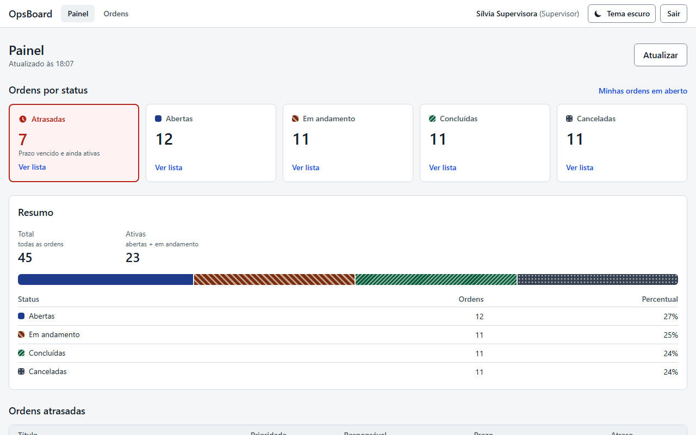
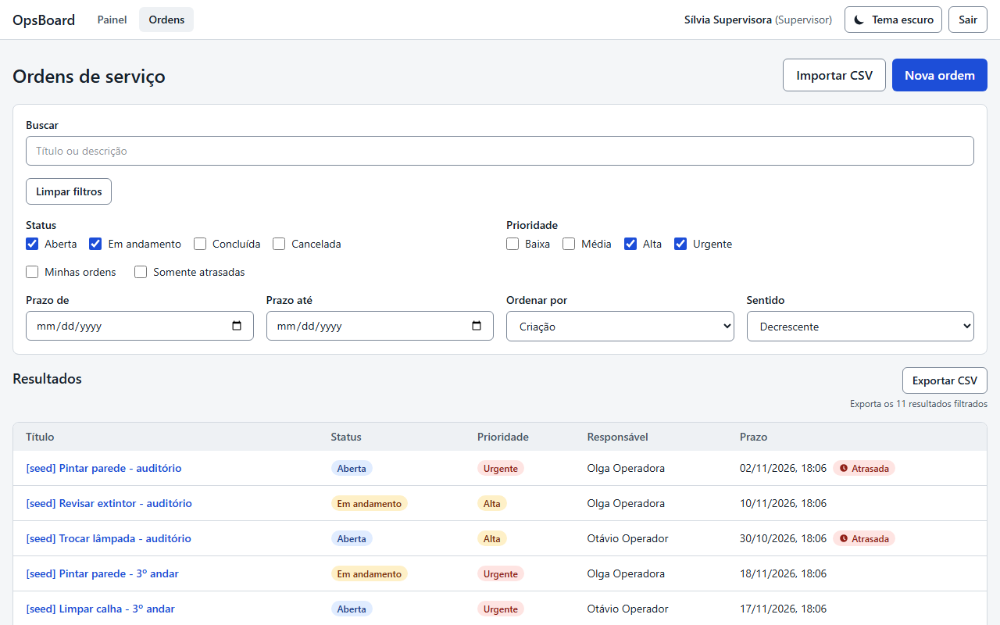
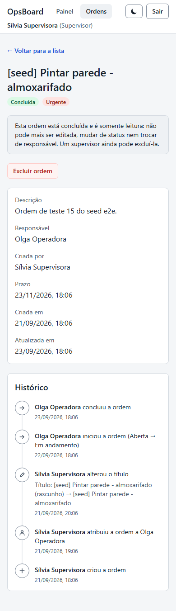
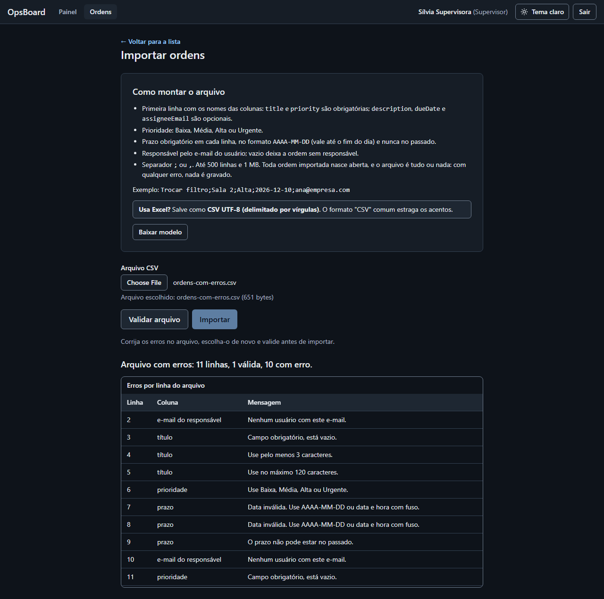
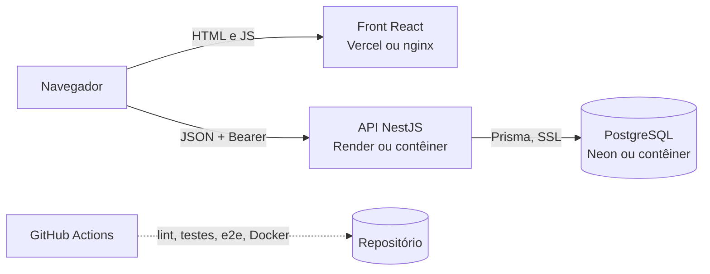

# OpsBoard

Painel de ordens de serviço full-stack: operadores e supervisores acompanham ordens do pedido à
conclusão, com permissões por perfil, histórico de cada ordem, painel e importação e exportação CSV.

[](https://github.com/Name-Less-Dev/opsboard/actions/workflows/ci.yml)
[](https://opsboard-sage.vercel.app)
[](LICENSE)

## Demonstração

- **App:** https://opsboard-sage.vercel.app
- **API (Swagger):** https://opsboard-api-yo0n.onrender.com/docs
- **Vídeo de demonstração (1min45):** https://youtu.be/WrFAqDDFVOc

> A API está no plano gratuito do Render e **dorme após 15 minutos sem uso**: o primeiro acesso pode
> levar cerca de 1 minuto. Se o login demorar, abra [https://opsboard-api-yo0n.onrender.com/health](https://opsboard-api-yo0n.onrender.com/health),
> espere responder e tente de novo. Os dados são **fictícios e redefinidos periodicamente**.

### Credenciais de demonstração

| Perfil      | E-mail                    | Senha           | O que pode fazer                                                            |
| ----------- | ------------------------- | --------------- | --------------------------------------------------------------------------- |
| Supervisora | `supervisora@example.com` | `opsboard-demo` | Tudo: criar para qualquer pessoa, atribuir, cancelar, excluir, importar CSV |
| Operadora   | `ana@example.com`         | `opsboard-demo` | Criar para si, iniciar e concluir as próprias ordens, exportar CSV          |
| Operador    | `bruno@example.com`       | `opsboard-demo` | Igual à operadora                                                           |

Para testar a importação na demonstração, use o **Baixar modelo** da própria tela: os arquivos de
[docs/examples](docs/examples) usam os e-mails do ambiente local e acusam responsável desconhecido lá.

## Capturas de tela

| Painel                                                                                                  | Lista com filtros                                                                                     |
| ------------------------------------------------------------------------------------------------------- | ----------------------------------------------------------------------------------------------------- |
|  |  |

| Detalhe com histórico (celular)                                                                                          | Relatório de erros da importação (tema escuro)                                                                    |
| ------------------------------------------------------------------------------------------------------------------------ | ----------------------------------------------------------------------------------------------------------------- |
|  |  |

Todas as capturas, nos dois temas, em desktop e celular, estão em [docs/screenshots](docs/screenshots).
São geradas pelo Playwright com dados fictícios (`npm run e2e:screenshots`).

## Funcionalidades

1. **Login e dois perfis** (operador e supervisor), com JWT e limite de tentativas por IP.
2. **Ordens de serviço** com validação: título, descrição, prioridade, responsável e prazo.
3. **Fluxo de status** Aberta → Em andamento → Concluída (ou Cancelada), com regra de quem pode cada
   transição e 409 quando a ordem mudou no meio do caminho.
4. **Lista** com busca, filtros, ordenação e paginação na URL, e estados de carregamento, erro e vazio.
5. **Painel** com contadores por status e ordens atrasadas, cada card levando à lista filtrada.
6. **Histórico** de cada ordem: quem fez o quê e quando, gravado na mesma transação da mudança.
7. **CSV**: exportar a lista filtrada (com proteção contra fórmulas) e importar em lote, com validação
   linha a linha e gravação tudo ou nada.

Tema claro e escuro, layout para celular e acessibilidade verificada com axe nos dois temas.

## Stack e arquitetura

| Camada | Tecnologia                                                                           |
| ------ | ------------------------------------------------------------------------------------ |
| Front  | React 19, TypeScript, Vite, Tailwind CSS 4, TanStack Query, React Hook Form + Zod    |
| API    | NestJS 11, TypeScript, Passport (JWT), class-validator, Swagger                      |
| Banco  | PostgreSQL 17, Prisma 7                                                              |
| Testes | Jest + supertest (API), Vitest + Testing Library + MSW (web), Playwright + axe (e2e) |
| Infra  | Docker Compose (local), GitHub Actions (CI), Vercel + Render + Neon (demonstração)   |



No Docker Compose, o nginx serve o front e repassa `/api` para a API, na mesma origem. Na demonstração,
o front no Vercel chama a API do Render diretamente (`VITE_API_URL`), com CORS liberado só para ele.
Detalhes do deploy em [docs/DEPLOY.md](docs/DEPLOY.md).

## Como rodar com Docker Compose

Pré-requisitos: [Docker Desktop](https://www.docker.com/products/docker-desktop/) e Git. (Node.js 24 só
para desenvolver fora do Docker.)

```bash
git clone https://github.com/Name-Less-Dev/opsboard.git
cd opsboard
cp .env.example .env
```

Troque o `JWT_SECRET` do `.env` por um valor seu, com pelo menos 32 caracteres (a API em contêiner roda
em modo produção e recusa o valor de exemplo). Para gerar um:

```bash
openssl rand -hex 32
```

Suba tudo e crie os dados de exemplo:

```bash
docker compose up --build -d --wait
docker compose run --rm migrate npx prisma db seed
```

| Serviço | Endereço                     |
| ------- | ---------------------------- |
| App     | http://localhost:8080        |
| API     | http://localhost:3000/health |
| Swagger | http://localhost:3000/docs   |

Entre com `supervisor@opsboard.dev` / `opsboard123` (ou `ana@opsboard.dev` e `bruno@opsboard.dev`, mesma
senha). Essas credenciais são só do ambiente local. Para parar: `docker compose down` (os dados
ficam); para apagar tudo: `docker compose down -v`.

Para desenvolver com hot reload, variáveis de ambiente e scripts, veja a
[referência técnica](docs/REFERENCIA.md#desenvolvimento-hot-reload).

## Como rodar os testes

```bash
docker compose up -d db
npm ci
npm run ci
```

`npm run ci` roda o mesmo que o CI sem Docker: lint, typecheck, testes da API (unitários e integração
com Postgres, com cobertura), testes do web e a checagem do contrato OpenAPI.

```bash
npm run e2e:install
npm run e2e
```

`npm run e2e` sobe o Postgres se precisar, recria o banco dedicado `opsboard_e2e`, compila API e front
e roda o Playwright (cerca de 1 minuto). Relatório: `npx playwright show-report apps/web/playwright-report`.
Detalhes de cada camada em [docs/REFERENCIA.md](docs/REFERENCIA.md#testes).

O CI (GitHub Actions) roda seis jobs a cada push e pull request: lint e typecheck, API, web, contrato,
e2e e a subida do Docker Compose.

## Decisões de projeto

As principais, em formato curto (contexto, decisão, alternativa, consequência), em
[docs/DECISOES.md](docs/DECISOES.md):

- política de permissões em funções puras;
- 409 nas transições;
- transação condicionada ao status contra corrida;
- histórico append-only (e por que não é event sourcing);
- filtros na URL;
- `code` de erro estável;
- neutralização de fórmulas no CSV;
- importação tudo ou nada com `dryRun`;
- regra de atraso duplicada no front;
- rate limit em memória;
- e2e contra a pilha compilada com banco dedicado.

O registro completo, dia a dia, está no [CLAUDE.md](CLAUDE.md).

## Limitações conhecidas

- A busca (`q`) diferencia acentos: "manutencao" não acha "manutenção". A solução futura é a extensão `unaccent` do Postgres.
- **Prazo sempre obrigatório**: `dueDate` é `NOT NULL`, então não existe ordem sem prazo (nem no CSV, nem nos dados da demonstração).
- **Limite de login em memória**: cada instância da API conta à parte e reiniciar zera a contagem. Com várias instâncias, o limite efetivo é multiplicado; resolver exigiria um armazenamento compartilhado (como Redis), fora do escopo.
- **IP atrás do nginx no compose**: o nginx não repassa o IP do cliente e o compose usa `TRUST_PROXY=0`, então quem acessa pela porta 8080 divide uma única contagem de tentativas. Corrigir exige `TRUST_PROXY=1`, o nginx definir `X-Forwarded-For` e a porta 3000 deixar de ser publicada (senão o acesso direto forja o IP).
- **Token no `localStorage`**: sobrevive ao recarregar e não sofre CSRF, mas um XSS consegue lê-lo. A expiração de 1h limita o estrago.
- **Sem refresh token**: quando o token expira, é preciso entrar de novo.
- **Filtro por responsável só via "Minhas ordens"**: a API aceita `assigneeId` com qualquer usuário, mas a tela de lista não tem um seletor de responsável.
- **Ações da tela duplicam a política do back** (`features/work-orders/permissions.ts`): o front só decide o que mostrar, e a API continua decidindo o que vale. Se a política mudar, os dois lados e as duas matrizes de teste mudam juntos.
- **Excluir a ordem apaga o histórico dela**: os eventos saem em cascata. Uma auditoria completa exigiria exclusão lógica (marcar a ordem como excluída em vez de apagar).
- **Descrição alterada registra só o campo**: a API mostra que a descrição mudou, não o texto antes e depois.
- **Histórico sem filtros nem exportação**: só a linha do tempo paginada de cada ordem, sem busca e sem feed geral de atividades.
- **O front interpreta `details` pelo contrato gerado** (`api-types.ts`), não pelo JSON bruto do banco: um tipo de evento novo só ganha texto próprio depois de regenerar o contrato e ensinar o `describeEvent`; até lá aparece como "Alteração registrada por …".
- **Painel sem atualização automática**: os números só mudam ao abrir a tela (depois de 30 s), pelo botão "Atualizar" ou depois de uma ação feita neste navegador. Mudanças feitas por outra pessoa só aparecem ao atualizar.
- **Painel sem métricas por responsável, prioridade ou período**: a API entrega só contadores por status e as atrasadas, e o painel não calcula nada por conta própria.
- **Regra de "atrasada" duplicada no front** (`features/work-orders/overdue.ts`): a lista não traz esse campo, então o selo é calculado no navegador com a mesma regra da API. A API continua sendo a fonte da verdade (é ela que filtra `overdue=true`); se a regra mudar, os dois lados e seus testes mudam juntos.
- **Importação sempre cria ordens novas**: não atualiza ordens existentes e não detecta duplicadas. Importar o mesmo arquivo duas vezes cria tudo duas vezes.
- **Sem atualização em lote por CSV**: mudar status, responsável ou outros campos de várias ordens continua sendo uma a uma.
- **Importação síncrona de até 500 linhas**: o arquivo é validado e gravado na própria requisição, numa transação. Volumes maiores exigiriam uma fila e processamento em segundo plano, fora do escopo.
- **Exportação limitada a 10.000 linhas** (`EXPORT_MAX_ROWS`): acima disso é preciso filtrar mais. O arquivo é montado em memória, sem streaming.
- **A exportação não serve de entrada para a importação**: ela traz nomes, não e-mails, e tem colunas (`id`, `status`, datas) que a importação não aceita.
- **Só supervisor importa**: o operador não vê o botão, a tela mostra acesso negado e a API responde 403.
- **e2e só no Chromium**, com um projeto que emula celular. Firefox e WebKit ficaram de fora.
- **e2e serial, com um banco compartilhado**: um worker só, sem paralelismo. Cada teste cria os próprios dados e compara contagens por diferença.
- **Sem teste de carga e sem teste visual por comparação de imagens.** As capturas de `docs/screenshots/` são para o README, não para comparar.
- **Campos nativos em inglês nas capturas**: o Chromium headless usado pelo Playwright não traz as traduções da interface, então o campo de data e o botão de arquivo aparecem em inglês nas imagens. No navegador de quem usa, eles seguem o idioma do sistema.
- **Demonstração no plano gratuito**: a API no Render dorme após 15 minutos sem tráfego e leva cerca de 1 minuto para acordar; uma instância só; o banco tem os limites do plano free do Neon.
- **Migrations de produção manuais**: o plano free do Render não roda comando antes do deploy e a imagem de runtime não tem o CLI do Prisma; elas são aplicadas do terminal com a URL direta do Neon ([docs/DEPLOY.md](docs/DEPLOY.md)). No Docker Compose rodam sozinhas.
- **`TRUST_PROXY` medido, não documentado**: o Render não publica quantos proxies há na frente da API; o valor `3` foi medido. Se a rede deles mudar, o limite de login volta a contar pelo IP do proxy.
- **CORS só para a URL de produção do front**: deploys de preview do Vercel não conseguem falar com a API.

## O que eu faria a seguir

- **Sessão:** refresh token rotativo em cookie `httpOnly`, para não depender do `localStorage`.
- **Busca sem acento** com a extensão `unaccent` do Postgres, e paginação por cursor para listas grandes.
- **Exclusão lógica**, para o histórico sobreviver à exclusão da ordem.
- **Limite de login compartilhado** (por exemplo em Redis), se a API tiver mais de uma instância.
- **Seletor de responsável na lista**, aproveitando o filtro `assigneeId` que a API já aceita.
- **Observabilidade básica** (logs estruturados para um coletor e alertas) antes de qualquer uso real.

## Mais documentação

- [docs/REFERENCIA.md](docs/REFERENCIA.md): API, formatos, regras de negócio, front-end, banco e scripts.
- [docs/DEPLOY.md](docs/DEPLOY.md): deploy da demonstração do zero e variáveis de produção.
- [docs/DECISOES.md](docs/DECISOES.md): decisões de projeto.

## Licença

[MIT](LICENSE) © Matheus Bezerra
